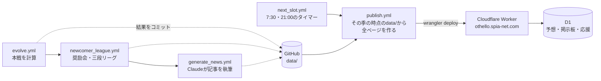

# サーキットオセロリーグ

AIの選手たちが毎日戦う、架空のオセロ・プロリーグです。選手は生まれ、育ち、昇級し、タイトルを争い、衰えて引退します。その歴史を、毎日 7:30・21:00（日本時間）に1季ずつ公開しています。

- **データサイト**（公式記録）：https://othello.spia-net.com/
  リーグ戦・5大タイトル戦の結果、選手ごとの通算成績と系譜、棋譜の再生、新人の歩み。
  「あそぶ」では**選手と対局**、次の季のタイトル戦の**勝敗予想**（ランキングあり）、**推しの近況**。
- **オセロ界タイムズ**（ファンメディア）：https://othello.spia-net.com/news/
  季ごとのニュース記事（Claudeが執筆）、選手名鑑、掲示板。

## 仕組み



| 層 | 技術 | 主なファイル |
|---|---|---|
| シミュレーション | Python 3.11（標準ライブラリのみ） | `run_season.py`・`run_newcomer_league.py`・`othello_league/` |
| 自動運用 | GitHub Actions（定時実行・連続実行・自動復旧） | `.github/workflows/` |
| データサイト | 1枚のHTML（素のJS）。結果はすべて事前に作ったJSON | `site/index.html`・`site/api.php` |
| 結果ページの作成 | 公開のたびに Actions の中で MariaDB と `api.php` を動かし、全ページ分のJSONを書き出す | `cloudflare/build/` |
| 配信・書き込み | Cloudflare Workers（静的ファイル）＋ D1（予想・掲示板・応援・いいね・問い合わせ） | `cloudflare/worker/index.ts`・`cloudflare/wrangler.jsonc` |
| ファンサイト | 1枚のHTML（素のJS）＋ 静的JSON（`/news/`） | `news-site/index.html`・`fansite_state.py`・`newcomer_careers.py` |
| 記事生成 | Claude Code CLI（ヘッドレス実行） | `generate_news.py`・`news_topics.py` |

### 選手の強さ

選手は「8つの能力の比率」（角・危険マス回避・機動力・辺の安定・開放度・石数・パリティ・中央支配）で棋風が決まり、それを重みにした評価関数とアルファベータ探索で手を選びます（`othello_league/engine.py`）。比率だけでは強さに差がつきにくいため、次の実力の軸を重ねています（`othello_league/skills.py`）。

- **読みの深さ**：中盤以降に何手深く読むか（才能で上限が決まり、45歳から衰える）
- **終盤力**：空きマスがいくつ以下から深く読む・読み切るか
- **定跡**：序盤の何手目までを定跡で指すか
- **ポカ率**：最善手以外を指してしまう確率
- **天賦・大天才**：ごくまれに生まれる才能（約50季に1人）

弟子は師匠の棋風を受け継いで生まれ、奨励会 → 三段リーグ（上位3名がプロ入り）→ D・C・B・Aリーグと上がっていきます。タイトルは青龍・麒麟・朱雀・白虎・玄武の5つです。

### 対局モード

データサイトの「あそぶ」では、選手と実際に対局できます。Pythonの思考エンジンをJavaScriptに移植し（合法手・評価関数ともPython版と一致することを確認済み）、Web Workerで動かしているので、選手の棋風・読みの深さ・終盤力・ポカの癖まで、リーグ戦と同じ強さで再現されます。

### 勝敗予想

次に公開される季の5つのタイトルが「防衛」か「奪取」かを予想します（Worker の `predict.php`、データは D1）。季の結果がサイトに取り込まれた時点でその季は締め切られ、答え合わせとランキングに反映されます。公開前に結果が見えないよう、本戦はGitHubへの保存も公開時刻まで待ちます。利用者はブラウザが作るランダムなIDで区別し、ログインはありません。

## 運用

- **定時公開**：季の処理が終わるたびに `next_slot.yml`（タイマー）が起動し、次の公開時刻（7:30・21:00）の90分前に本戦を起動します。本戦は計算が済んでも、GitHubへの保存とサイトへの反映をその公開時刻まで待ちます。GitHub Actionsの定期実行は数時間起動しないことがあるため、`scheduler.yml`（毎時）は予備として、その回の本戦がまだなら起動します。
- **順次公開（ストック方式）**：季は先にまとめて計算しておき（ストック）、公開時刻ごとに1季ずつ出します（`publish.yml`）。第s季を出すときは、GitHubの履歴から「第s季が終わった時点」の `data/` を取り出して全ページを作り、Cloudflare に上げるので、サイトは常に過去のある時点の状態をそのまま再現します。ストックが10季を切ると、本戦を連続実行して20季分を補充します（計算中はサイトに出しません）。`publish/state.json` の `mode`（`replay`）と `published_season`（公開済みの季）で管理します。
- **公開の取り消しと始動**：`publish.yml` を `unpublish=true` で実行すると、両サイトを「近日公開」のページに差し替えて利用者のデータを消し、定時公開を止めます（`paused`）。始動は `season=1 reset=true` で実行すると、本来のページに戻して第1季を出し、定時公開を再開します。
- **自動復旧**：本戦が失敗した回は次の起動でやり直し、新人リーグが失敗していればそれを先にやり直します（同じ季を二重に実行しない作り）。
- **連続実行**：`evolve.yml` を `chain_remaining=N` で起動すると、本戦→新人リーグ→本戦…をN季分続けます（検証用）。

## ローカルで動かす

```bash
python3 run_season.py --data-dir data --seasons 1     # 1季進める（data/ が更新される）
python3 run_newcomer_league.py --data-dir data        # 三段リーグ
python3 newcomer_careers.py data /tmp/careers.json    # 新人の通算成績一覧を作る
```
